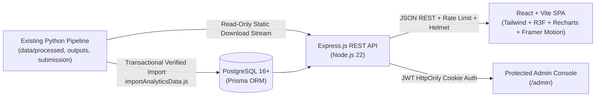

# RR PERFORMANCE LAB — Application Architecture (Stage 1)

**Project:** SupeRR Selector Season 2 — **RR PERFORMANCE LAB**  
**Tagline:** *Beyond the Numbers. Inside the Pressure.*  
**Scope:** Independent historical cricket performance intelligence platform (IPL & T20I, 2022–2026). Not an official Rajasthan Royals product; uses an original text-based brand identity and permanent design system.

---

## 1. Architectural Principles

1. **Analytical Single Source of Truth:** All player stats, pressure indices, Empirical Bayes estimates, reliability scores, confidence intervals, and final Top 10 rankings are imported directly from verified Phase 3–6 Python outputs (`data/processed/`, `outputs/`, `submission/`). The web backend **never recalculates** rankings in JavaScript and **never permits manual ranking edits** via UI forms.
2. **Strict Preservation of Analytical Project:** All web application code lives strictly inside `SupeRR_Selector/webapp/`. Existing scripts (`src/`), raw data (`data/raw/Data Pack/`), processed data (`data/processed/`), notebooks (`notebooks/`), reports (`report/`), tests (`tests/`), and competition deliverables (`submission/`) remain 100% untouched.
3. **Conceptual Separation Preserved in UI & Schema:**
   - **Match Pressure (`0–100`):** Pre-delivery situation difficulty only (Model C primary; Models A & B for comparison). `UNAVAILABLE` contexts (`1,551` deliveries) are explicitly labeled and never collapsed into `LOW PRESSURE`.
   - **Performance Effectiveness:** Format- and context-adjusted RVAE/RSAE + wicket value, shrunk via Empirical Bayes (`k = 8.65` batting, `k = 30.00` bowling).
   - **Reliability (`0–100`, Volume-Free):** Cross-innings/condition/season consistency on variance-stabilized spell residuals (`NULL` for `INSUFFICIENT_EVIDENCE`, never `0`).
   - **Evidence Strength (`0–100`) & Uncertainty:** Sample size, multi-season breadth, match-clustered bootstrap 95% CIs, and Monte Carlo Top-10 probabilities shown alongside every ranking.
4. **No Raw Delivery Flooding:** The `193,988`-row `pressure_deliveries.csv` is **never** shipped to the browser. All interactive Pressure/Batting/Bowling filters query server-side pre-aggregated PostgreSQL summary cubes (`<15ms`), while match exploration uses server-side filtering, sorting, and pagination.

---

## 2. System Topology



---

## 3. Target Folder Structure (`SupeRR_Selector/webapp/`)

```text
SupeRR_Selector/webapp/
├── frontend/
│   ├── public/
│   │   └── hero-poster.webp            # Optimized static night-stadium poster for instant LCP / fallback
│   ├── src/
│   │   ├── assets/                     # Local SVG icons & brand marks (original text-based RR logo)
│   │   ├── charts/                     # Reusable Recharts wrappers (RR Dark/Light tokens, tabular nums)
│   │   ├── components/
│   │   │   ├── common/                 # KPI cards, badges, DataTable, Loading/Empty/Error states
│   │   │   ├── hero/                   # StadiumScene3D (R3F), HeroFallback, HeroOverlay
│   │   │   ├── layout/                 # Navbar (grouped dropdowns + global search), MobileDrawer, Footer
│   │   │   └── admin/                  # ProtectedRoute, ImportMonitor, ReconcilePanel
│   │   ├── hooks/                      # useApi, useUrlFilters, useTheme, useReducedMotion, useWebGLSupport
│   │   ├── layouts/                    # MainLayout, AdminLayout
│   │   ├── pages/
│   │   │   ├── HomePage.jsx            # Cinematic 3D hero + 7 analytical showcase sections
│   │   │   ├── AboutPage.jsx           # Challenge overview, scope, workflow, limitations
│   │   │   ├── PressureIntelligencePage.jsx  # Chase / Inn 1 / Bowling + Model A/B/C + interactive filters
│   │   │   ├── BattingAnalyticsPage.jsx      # KPIs, charts, interactive filters, sortable Top 10 & full pool
│   │   │   ├── BowlingAnalyticsPage.jsx      # KPIs, charts, interactive filters, sortable Top 10 & full pool
│   │   │   ├── PlayerExplorerPage.jsx        # Searchable directory (All / Batters / Bowlers)
│   │   │   ├── PlayerProfilePage.jsx         # /players/:playerId — Overview, Perf, Rel, Trends, Rank, Auto-Explanation
│   │   │   ├── ComparePlayersPage.jsx        # 2–4 player same-discipline comparison (batter vs batter, bowler vs bowler)
│   │   │   ├── MatchExplorerPage.jsx         # Server-paginated match/innings archive
│   │   │   ├── MatchDetailPage.jsx           # /matches/:matchId — innings summary & pressure profile
│   │   │   ├── MethodologyPage.jsx           # 20 transparent sections + equations + diagrams + PDF link
│   │   │   ├── ReportsPage.jsx               # Official submission/ downloads library
│   │   │   └── admin/
│   │   │       ├── AdminLoginPage.jsx
│   │   │       └── AdminDashboardPage.jsx
│   │   ├── services/                   # Typed fetch wrapper (api.js)
│   │   ├── styles/                     # tokens.css (RR palette + dark/light CSS variables), index.css
│   │   └── utils/                      # formatters (tabular numbers, CI ranges, deterministic explanation builder)
│   ├── index.html
│   ├── vite.config.js
│   ├── tailwind.config.js
│   ├── vercel.json
│   └── package.json
├── backend/
│   ├── prisma/
│   │   ├── schema.prisma               # PostgreSQL relational schema (18 tables)
│   │   └── seedAdmin.js                # Env-driven initial admin seeder (bcrypt)
│   ├── scripts/
│   │   ├── importAnalyticsData.js      # Transactional, idempotent CSV importer + pre-aggregator
│   │   └── verifyConsistency.js        # Exact Top-10 & count reconciliation against submission/*.csv
│   ├── src/
│   │   ├── config/                     # env.js (Zod-validated), prisma.js, paths.js, cache.js
│   │   ├── controllers/                # Route handlers per domain
│   │   ├── middleware/                 # auth.js, validate.js, errorHandler.js, rateLimiter.js
│   │   ├── routes/                     # Express routers mounted under /api/*
│   │   ├── services/                   # Query services, deterministic explanation generator, report resolver
│   │   ├── utils/                      # pagination, safe sorting allowlists, response envelope
│   │   ├── app.js                      # Express app factory (importable by Supertest without binding port)
│   │   └── server.js                   # HTTP listener entrypoint
│   ├── tests/                          # Vitest + Supertest API, import, auth, consistency tests
│   └── package.json
├── docs/
│   ├── APPLICATION_ARCHITECTURE.md
│   ├── DATABASE_SCHEMA.md
│   ├── API_DOCUMENTATION.md
│   └── DEPLOYMENT_GUIDE.md             # Created in Stage 9
├── .env.example
└── README.md
```

---

## 4. Design System & Theme Mapping

Directly aligned with `SupeRR_Selector/dashboard/DESIGN_SYSTEM.md`:

| Token | Name | Hex | Role |
| :--- | :--- | :--- | :--- |
| `--bg-primary` | Deep Plum | `#24172C` | Dark-mode primary canvas (default theme) |
| `--bg-surface` | Secondary Plum | `#392940` | Elevated cards, chart containers, table headers, subtle glass (`rgba(57,41,64,0.78)`) |
| `--accent-pink` | Royals Pink | `#E83E80` | Active nav state, primary CTA, spotlight series |
| `--accent-gold` | Royals Gold | `#D8B45A` | Rank #1 badges, benchmark reference lines, floodlight gold accents |
| `--text-primary` | Soft Light | `#F5F1F5` | Primary typography on dark surfaces; restrained light-mode canvas |
| `--text-muted` | Muted Lavender | `#B8A6C2` | Secondary copy, axis labels, subtle `rgba(184,166,194,0.18)` borders |
| `--semantic-pos` | Analytical Teal | `#4FD1A5` | Above-par RVAE/RSAE & positive reliability deltas |
| `--semantic-neg` | Muted Coral | `#F26A6A` | Below-par impact & high-risk uncertainty flags |
| `--series-blue` | Analytical Blue | `#7C9EF2` | Secondary series (e.g., T20I vs IPL split, Extreme & Lift pillar) |

- **Typography:** `Plus Jakarta Sans` / `Inter` for UI & editorial headings; `JetBrains Mono` + `font-variant-numeric: tabular-nums` on every numeric KPI, rank, CI, and table column.
- **Navigation Architecture (Clean, Non-Crowded):**
  - Top bar: Original text mark **RR PERFORMANCE LAB**, compact links: `Home`, `Analytics ▾` (`Pressure Intelligence`, `Batting`, `Bowling`, `Match Explorer`), `Players ▾` (`Player Explorer`, `Compare Players`), `Research ▾` (`About`, `Methodology`, `Reports`), plus an instant Global Player Search modal (`Ctrl+K` / search button) and dark/light theme toggle.
  - Mobile (`<1024px`): Collapsible drawer with grouped sections and touch-friendly targets.

---

## 5. Cinematic 3D Homepage Approach (Stage 4 Blueprint)

**Requirement:** Full-screen night-time cricket stadium that feels like a moving 3D video without external paid APIs, fake static video claims, or slowing down analytics pages.

### Chosen Hybrid Architecture: Lazy-Loaded React Three Fiber (WebGL) + Optimized Static Poster + Graceful Fallback

1. **Instant First Paint (0ms WebGL block):** Render an optimized local static night-stadium hero poster (`public/hero-poster.webp` / layered plum-pink-gold radial stadium SVG canvas) immediately while the lazy-loaded Three.js chunk hydrates asynchronously (`React.lazy` + `Suspense`).
2. **Interactive 3D Stadium Environment (`StadiumScene3D.jsx` via `@react-three/fiber` + `three`):**
   - **Geometry & Lighting:** Procedural curved lower/upper stadium bowl ribs in deep plum (`#24172C` / `#392940`), central illuminated 22-yard cricket pitch strip with subtle crease markings and emerald-slate night turf, and **4 stadium floodlight towers** casting soft volumetric light cones (custom translucent additive shader cones in warm gold `#D8B45A` and pink haze `#E83E80`).
   - **Hero Focal Subject:** High-detail rotating 3D crimson-pink & gold-stitched cricket ball hovering in dramatic foreground depth-of-field above the pitch (with subtle specular sheen and embossed seam), framed against glowing floodlights.
   - **Atmospheric Motion:** 350 lightweight GPU-instanced dust/dew motes drifting through the floodlight beams (`THREE.Points`, 1 draw call).
   - **Cinematic Camera Dolly:** Slow, smooth sinusoidal orbital camera sweep (`useFrame`) paired with subtle damped pointer parallax (`±3°`) for authentic cinema-camera depth.
3. **Performance & Accessibility Guardrails:**
   - **Code-Split Isolation:** `three`, `@react-three/fiber`, and `@react-three/drei` are dynamically imported **only** on `HomePage.jsx` — zero bytes loaded on `/batting`, `/bowling`, `/players`, `/compare`, `/methodology`, or `/reports`.
   - **Reduced Motion & Mobile Fallback:** Automatically switches to the lightweight CSS 3D layered parallax / static poster mode when `prefers-reduced-motion: reduce` is active, when WebGL context creation fails, or when `navigator.hardwareConcurrency <= 2` / narrow low-power mobile viewport is detected.
   - **Canvas Pause:** Unmounts/pauses the `requestAnimationFrame` loop once the user scrolls past the hero fold (`IntersectionObserver`).

---

## 6. Security & Administration Architecture

- **Public Analytics:** Read-only, zero login required, no public signup.
- **Admin Area (`/admin`):**
  - Credentials seeded strictly via environment variables (`ADMIN_EMAIL`, `ADMIN_PASSWORD` hashed with `bcryptjs` cost 12 into `admin_users`). Never embedded in frontend code.
  - Authentication via signed JWT stored in `HttpOnly`, `SameSite=Lax`, `Secure` (prod) cookie (`POST /api/admin/auth/login`, `POST /api/admin/auth/logout`, `GET /api/admin/auth/me`).
  - Rate-limited login endpoint (`express-rate-limit`), security headers via `helmet`, strict CORS origin allowlist, and Zod input validation on every query/body.
  - **No Manual Ranking Edits:** Admin panel supports monitoring DB health, viewing import logs & errors, triggering validated re-import from verified Python CSVs, running exact reconciliation against `submission/*.csv`, clearing the server-side in-memory response cache, and inspecting audit logs.

---

## 7. Dependency & Installation Plan

### Verified Local Machine Environment
- **Node.js:** `v22.16.0` (verified present)
- **npm:** `10.9.2` (verified present)
- **Python (Existing Pipeline):** `3.15.2` in `SupeRR_Selector\.venv` (`33/33` pytest passing)
- **PostgreSQL / Docker:** **Not currently installed locally** (`psql` and `docker` absent from PATH and `C:\Program Files`). See Section 8 for provisioning options prior to Stage 2.

### Backend Packages (`webapp/backend/package.json`)
- **Runtime:** `express`, `@prisma/client`, `prisma`, `dotenv`, `cors`, `helmet`, `express-rate-limit`, `cookie-parser`, `jsonwebtoken`, `bcryptjs`, `zod`, `csv-parse`, `compression`, `morgan`
- **Dev / Test:** `vitest`, `supertest`, `nodemon`

### Frontend Packages (`webapp/frontend/package.json`)
- **Runtime:** `react`, `react-dom`, `react-router-dom`, `framer-motion`, `recharts`, `three`, `@react-three/fiber`, `@react-three/drei`, `lucide-react`
- **Dev / Test:** `vite`, `@vitejs/plugin-react`, `tailwindcss`, `@tailwindcss/vite` (or `postcss` + `autoprefixer`), `vitest`, `@testing-library/react`, `@testing-library/jest-dom`, `jsdom`

---

## 8. Identified Risks, Schema Gaps & Mitigations

| # | Risk / Gap | Evidence from Stage 1 Audit | Planned Mitigation |
|---|---|---|---|
| 1 | **PostgreSQL Not Installed Locally** | `psql`, `docker`, and `C:\Program Files\PostgreSQL` are absent on this Windows machine. | Before Stage 2 execution, either (A) provide a free-tier PostgreSQL `DATABASE_URL` (e.g., Neon or Supabase) in `webapp/backend/.env`, or (B) install local PostgreSQL 16 (`winget install PostgreSQL.PostgreSQL.16`). |
| 2 | **`report/phase_6_completion_summary.md` Absent** | Phase 6 methodology & summary lives in `submission/RR_Performance_Lab_Methodology_Report.md` (`341` lines, 20 sections), not `report/`. | Methodology seeder reads `submission/RR_Performance_Lab_Methodology_Report.md` directly and links directly to `submission/*.pdf` / `*.csv` / `*.xlsx`. |
| 3 | **Phase 5 Summary vs. Updated Reliability CSVs** | `report/phase_5_completion_summary.md` cites pre-refinement reliability mean (`36.26`/`36.05`), while `player_*_reliability.csv` and Phase 6 outputs use variance-stabilized spell residuals (`34.62`/`35.19`). | Import exclusively from processed/submission CSVs so DB, APIs, and UI share one consistent numerical truth. |
| 4 | **Shared Player Names (`player_id` Collision Risk)** | 3 distinct player pairs share identical names (`Rashid Khan`, `Abdul Samad`, `Haider Ali`). | Strictly key all DB relations, API paths (`/api/players/:playerId`), and frontend routes (`/players/:playerId`) on integer `player_id`, displaying `player_id` & team context in search disambiguation. |
| 5 | **Nullable Reliability & Unavailable Pressure Context** | `511` batters and `343` bowlers have `reliability_score = NaN`; `1,551` deliveries have `UNAVAILABLE` pressure. | Store as SQL `NULL` (never `0`) and `'UNAVAILABLE'` (never `'LOW PRESSURE'`); render explicit `"Insufficient Evidence"` and `"Context Unavailable"` UI badges. |
| 6 | **193,988-Row Delivery CSV Size vs. Browser/DB Latency** | Streaming 194k rows to browser or querying raw deliveries live on serverless DB would hurt latency & storage. | Pre-aggregate `pressure_deliveries.csv` during import into compact PostgreSQL OLAP cubes (`pressure_cube`, `pressure_histogram_bins`, `discipline_filter_cube` — `<1,500` total rows) for instant `<15ms` multi-filter analytics. |
| 7 | **Serverless Ephemeral Filesystem on Deployment** | Local SQLite/files vanish on Vercel/ephemeral hosts. | Deploy frontend on **Vercel**, persistent Node/Express backend on **Render / Railway** (with `submission/` artifacts bundled/mounted read-only), and managed **PostgreSQL** (Neon / Supabase / Render Postgres). |
| 8 | **3D Hero WebGL Performance on Low-Power Devices** | Heavy 3D textures/models can slow mobile devices. | Use procedural low-poly Three.js geometry + 1-draw-call instanced particles, lazy-load Three.js exclusively on `/`, pause off-screen, and auto-fallback on `prefers-reduced-motion` / mobile / no-WebGL. |

