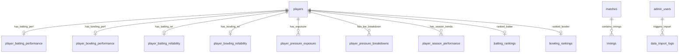

# RR PERFORMANCE LAB — Database Schema & Data Import Contract (Stage 1)

**Database Engine:** PostgreSQL 16+  
**ORM:** Prisma ORM (`webapp/backend/prisma/schema.prisma`)  
**Primary Identity Rule:** Integer `player_id` (from `player_master.csv`) is the immutable primary key across all player tables. Players sharing identical names (`Rashid Khan` `4722`/`20172`, `Abdul Samad` `6922`/`7446`, `Haider Ali` `7338`/`28756`) are **never** merged by name.

---

## 1. Verified Source CSV Inventory & Import Mapping

Every table in PostgreSQL maps strictly to verified files produced by Phases 2–6. Zero fields are fabricated.

| Target PostgreSQL Table | Source File(s) | Exact Source Rows | Primary / Unique Key | Notes |
| :--- | :--- | ---: | :--- | :--- |
| `players` | `data/processed/player_master.csv` | 1,217 | `playerId` (`PK`) | Canonical player directory, team names, IPL/T20I flags, `sharesNameWithOtherId` |
| `player_batting_performance` | `data/processed/player_batting_performance.csv` | 824 | `playerId` (`PK`, `FK → players`) | Overall, Pressure, Non-Pressure, IPL/T20I, Inn1/Chase, Phase splits + deltas |
| `player_bowling_performance` | `data/processed/player_bowling_performance.csv` | 596 | `playerId` (`PK`, `FK → players`) | Same structured splits for bowling (economy, RSAE, wickets, dot%, boundary%) |
| `player_batting_reliability` | `data/processed/player_batting_reliability.csv` + `player_pressure_vs_nonpressure.csv` | 824 | `playerId` (`PK`, `FK → players`) | `reliabilityScore` **nullable** (`NULL` for 511 `INSUFFICIENT_EVIDENCE` rows — never `0`) |
| `player_bowling_reliability` | `data/processed/player_bowling_reliability.csv` + `player_pressure_vs_nonpressure.csv` | 596 | `playerId` (`PK`, `FK → players`) | `reliabilityScore` **nullable** (`NULL` for 343 `INSUFFICIENT_EVIDENCE` rows — never `0`) |
| `player_pressure_exposure` | `data/processed/player_pressure_exposure.csv` | 1,420 | `(discipline, playerId)` | Ball counts across `LOW`, `MODERATE`, `HIGH`, `EXTREME`, `highExtremeSharePct` |
| `player_pressure_breakdowns` | `data/processed/player_batting_pressure_breakdown.csv` + `player_bowling_pressure_breakdown.csv` | 4,276 (`2,239` + `2,037`) | `(discipline, playerId, pressureLevel)` | Exact per-tier stats (`LOW`, `MODERATE`, `HIGH`, `EXTREME`) for Player Profile & Compare |
| `player_season_performance` | `data/processed/player_season_performance.csv` | 3,008 | `(discipline, playerId, seasonYear)` | 2022–2026 seasonal pressure trajectories (`primaryRate`, `netImpactRate`) |
| `batting_rankings` | `data/processed/final_batting_rankings.csv` + `outputs/top10_overlap_analysis.csv` + `submission/RR_Performance_Lab_Top_10_Batters.csv` | 173 (`10` shortlisted) | `playerId` (`PK`, `FK → players`), unique `rank` | Exact Phase 6 Balanced Primary scores, 4 normalized pillars, MC rank intervals, stability tier, `isTop10` |
| `bowling_rankings` | `data/processed/final_bowling_rankings.csv` + `outputs/top10_overlap_analysis.csv` + `submission/RR_Performance_Lab_Top_10_Bowlers.csv` | 165 (`10` shortlisted) | `playerId` (`PK`, `FK → players`), unique `rank` | Exact Phase 6 Balanced Primary scores, 4 normalized pillars, MC rank intervals, stability tier, `isTop10` |
| `ranking_robustness_audits` | `outputs/ranking_robustness.csv`, `ranking_method_comparison.csv`, `ranking_threshold_sensitivity.csv`, `shortlist_alternatives.csv` | 65 | `id` (`PK`), `(auditType, discipline, specKey)` | Powers Methodology sensitivity, Ranking Robustness, and Narrow-Misses views |
| `matches` | `data/processed/clean_matches.csv` + `data/processed/pressure_match_summary.csv` | 853 (`837` with balls, `16` abandoned) | `matchId` (`PK`) | Competition, season, venue, teams, DLS/completion flags, nullable match pressure metrics |
| `innings` | `data/processed/innings_summary.csv` + `data/processed/pressure_innings_summary.csv` | 1,652 | `(matchId, innings)` (`FK → matches`) | Runs, wickets, legal balls, extras breakdown, team names (resolved from `clean_matches`), innings pressure summary |
| `pressure_summaries` | `outputs/pressure_level_summary.csv`, `pressure_distribution.csv`, `pressure_model_comparison.csv`, `pressure_exposure_summary.csv`, `pressure_component_summary.csv` | 82 | `id` (`PK`), `(summaryType, framework, segmentKey)` | Exact Phase 4 summary tables (Models A/B/C comparison, distributions, components, UNAVAILABLE counts) |
| `pressure_analytics_cube` | Aggregated during import from `data/processed/pressure_deliveries.csv` (`193,988` rows) | ~450–650 | `(framework, matchFormat, season, innings, matchPhase, pressureLevel)` | Server-side OLAP cube enabling `<15ms` multi-filter queries on Pressure Intelligence, Batting & Bowling Analytics (includes mean RRR, CRR, runs remaining, balls remaining, wickets lost, wickets in hand, score, batting SR/avg/dot%/boundary%, bowling econ/wkts/dot%/boundary%, and 20-bin score histogram JSON) |
| `methodology_sections` | Parsed from `submission/RR_Performance_Lab_Methodology_Report.md` | 20 | `sectionNumber` (`PK`), unique `slug` | Full 20 methodology sections + formulas + structured highlights |
| `admin_users` | Seeded from `.env` (`ADMIN_EMAIL`, `ADMIN_PASSWORD`) | 1+ | `id` (`PK`), unique `email` | Bcrypt-hashed admin credentials & role (`ADMIN`), never exposed to client |
| `data_import_logs` | Generated by `importAnalyticsData.js` & Admin triggers | Growing | `id` (`PK`) | Import batch ID, timestamps, status, row counts JSON, reconciliation status, error details, actor |

---

## 2. Entity-Relationship Overview

---

## 3. Detailed Column & Constraint Rules

### 3.1 `players`
- `playerId Int @id`
- `displayName String` (from `standardized_display_name`)
- `teamNames String?`
- `inIpl Boolean`, `inT20i Boolean`, `inExcludedComp Boolean`, `inPrimaryEligibleComp Boolean`
- `primaryBallsFaced Int`, `primaryLegalBallsBowled Int`, `matchesInPlayingEleven Int`
- `battingType String?`, `bowlingType String?`, `paceOrSpin String?`
- `everWk Boolean`, `everCaptain Boolean`, `inferredPlayingRole String?`
- `sharesNameWithOtherId Boolean`
- **Indexes:** `@@index([displayName])`, `@@index([inPrimaryEligibleComp])`, `@@index([inferredPlayingRole])`

### 3.2 `player_batting_performance` & `player_bowling_performance`
- Foreign key `playerId Int @id` referencing `players(playerId)` with `onDelete: Cascade`.
- Stores all verified overall, pressure (`HIGH+EXTREME`), non-pressure (`LOW+MODERATE`), competition (`IPL` / `T20I`), innings (`Inn 1` / `Chase`), phase (`Powerplay` / `Middle` / `Death`), and pressure-vs-non-pressure delta fields.
- Missing division metrics (e.g., `batting_average` when `dismissals == 0`, or IPL splits for T20I-only players) stored strictly as SQL `NULL` (`Float?`), never coerced to `0`.
- **Indexes:** `@@index([battingRole])` / `@@index([bowlingRole])`, `@@index([pressureBallsFaced])` / `@@index([pressureLegalBalls])`.

### 3.3 `player_batting_reliability` & `player_bowling_reliability`
- `evidenceTier String` (`HIGH_CONFIDENCE`, `MODERATE_CONFIDENCE`, `LOW_EVIDENCE`, `INSUFFICIENT_EVIDENCE`)
- `isPrimaryEligible Boolean`
- `rawPressureImpact Float?`, `ebShrinkageWeight Float?`, `ebKMatchesPrior Float?`, `ebPressureImpact Float?`
- `inningsImpactIqr Float?`, `inningsImpactSd Float?`, `seasonalImpactSd Float?`
- `compInningsStability Float?`, `compFloorConsistency Float?`, `compCrossConditionStability Float?`, `compSeasonalStability Float?`
- `performanceScore Float?`, `reliabilityScore Float?` (**nullable — never `0` for `INSUFFICIENT_EVIDENCE`**), `evidenceStrengthScore Float?`
- `impactCi95Low Float?`, `impactCi95High Float?`, `impactCi95Width Float?`, `impactBootSe Float?`
- `rawRateCi95Low Float?`, `rawRateCi95High Float?`
- `contextImpactDiff Float?`, `contextImpactDiffCi95Low Float?`, `contextImpactDiffCi95High Float?`, `ci95ExcludesZero Boolean?`, `sufficientBothSidesPrimary Boolean?`, `evidenceInterpretation String?`
- **Indexes:** `@@index([evidenceTier])`, `@@index([isPrimaryEligible])`

### 3.4 `batting_rankings` & `bowling_rankings`
- `playerId Int @id`, `rank Int @unique`
- `isTop10 Boolean` (`rank <= 10`)
- `role String`, `teamContext String?`, `competitionContext String`, `seasonsRepresented String?`
- `finalRankingScore Float`, `performanceScore Float`, `reliabilityScore Float`, `evidenceScore Float`
- `normPerfScore Float`, `normRelScore Float`, `normExtremeAndLiftScore Float`, `normEvidenceScore Float`
- `scoreBalancedPrimary Float`, `scorePerformanceDominant Float`, `scoreReliabilityDominant Float`
- `rankPerformanceDominant Int`, `rankReliabilityDominant Int`
- `ebPressureImpact Float`, `rawPressureImpact Float`, `extremeBalls Int`, `extremeRawImpact Float?`, `extremePrimaryRate Float?`
- `impactCi95Low Float?`, `impactCi95High Float?`
- `mcRankP05 Float?`, `mcRankMedian Float?`, `mcRankP95 Float?`, `mcProbTop10Pct Float?`
- `methodsInTop10OutOf8 Int?`, `stabilityTier String?`, `keyStrengths String?`, `mainLimitation String?`, `confidenceDescription String?`
- **Indexes:** `@@index([isTop10])`, `@@index([finalRankingScore])`, `@@index([role])`, `@@index([competitionContext])`

### 3.5 `matches` & `innings`
- `matches`: `matchId Int @id`, `compId Int`, `compName String`, `matchFormat String`, `season String`, `matchDate DateTime`, `stage String?`, `venueId Int?`, `venueCountry String?`, `homeTeamId Int`, `homeTeam String`, `awayTeamId Int`, `awayTeam String`, `tossOpted String?`, `knockOut Boolean`, `result String?`, `hasBallData Boolean`, `isDlsMatch Boolean`, `isReducedOversMatch Boolean`, `matchCompletionClassification String`, `regularDeliveries Int`, `inn1TotalRuns Int?`, `inn1Wickets Int?`, `inn2TotalRuns Int?`, `inn2Wickets Int?`, plus nullable `meanI1Pressure`, `maxI1Pressure`, `meanChasePressure`, `maxChasePressure`, `meanBowlingPressure`, `maxBowlingPressure`, `highOrExtremeBattingBalls`, `highOrExtremeBowlingBalls`.
- `innings`: composite unique `@@unique([matchId, innings])`, `battingTeamId Int`, `battingTeamName String?`, `bowlingTeamId Int`, `bowlingTeamName String?`, `totalDeliveries Int`, `legalDeliveries Int`, `batterBallsFaced Int`, `totalRuns Int`, `wickets Int`, `bowlerWickets Int`, `wides Int`, `noballs Int`, `battingPressureValidBalls Int`, `bowlingPressureValidBalls Int`, `meanBattingPressure Float?`, `maxBattingPressure Float?`, `highOrExtremeBattingBalls Int`, `extremeBattingBalls Int`, `meanBowlingPressure Float?`, `maxBowlingPressure Float?`, `highOrExtremeBowlingBalls Int`, `extremeBowlingBalls Int`.
- **Indexes:** `matches(matchFormat, season)`, `matches(matchDate)`, `matches(compId)`, `innings(matchId)`.

### 3.6 `pressure_analytics_cube` (Pre-Aggregated Delivery Cube)
Aggregated deterministically from `data/processed/pressure_deliveries.csv` inside `importAnalyticsData.js` so Page 2 (Pressure Intelligence), Page 3 (Batting Analytics), and Page 4 (Bowling Analytics) support rich server-side cross-filtering without querying 193,988 rows per HTTP request:
- Dimensions: `framework` (`CHASE`, `FIRST_INNINGS`, `BOWLING`, `BATTING_COMBINED`), `matchFormat` (`IPL`, `T20I`), `season` (`2022`–`2026`), `innings` (`1`, `2`), `matchPhase` (`Powerplay`, `Middle`, `Death`, `Unavailable`), `pressureLevel` (`LOW PRESSURE`, `MODERATE PRESSURE`, `HIGH PRESSURE`, `EXTREME PRESSURE`, `UNAVAILABLE`).
- Pre-aggregated numerators/denominators (exact additive sums so server-side re-aggregation across any filter slice is mathematically exact, never averaging averages!):
  - `deliveriesCount Int`, `legalBallsCount Int`, `batterBallsFaced Int`, `runsTotal Int`, `batterRuns Int`, `bowlerConcededRuns Int`, `wicketsTotal Int`, `bowlerWickets Int`, `dotBallsBat Int`, `dotBallsBowl Int`, `boundaryBallsBat Int`, `boundaryBallsBowl Int`
  - Context sums for Pressure Intelligence displays: `sumPressureIndex Float`, `validPressureCount Int`, `sumRrr Float`, `validRrrCount Int`, `sumCrr Float`, `validCrrCount Int`, `sumRunsRemaining Float`, `validRunsRemCount Int`, `sumBallsRemaining Float`, `validBallsRemCount Int`, `sumWicketsLost Float`, `sumWicketsInHand Float`, `sumCumScore Float`, `sumBallsElapsed Float`
  - Histogram distribution: `scoreBinsJson Json` (`20` exact 5-point bins `0–5`, `5–10`, ..., `95–100` for Model C, Model A, and Model B).

---

## 4. Transactional Data Import & Reconciliation Contract (`importAnalyticsData.js`)

1. **Strict CSV Parsing:** Uses `csv-parse` with empty-string → `null` conversion while preserving literal `'None'` strings intact (matching Phase 3 rules).
2. **Pre-Import Schema Validation:** Verifies every required file exists and contains all mandatory columns before writing a single row.
3. **Idempotent Transactional Execution:**
   - Wraps analytical tables in a Prisma transaction (`$transaction`) with clean upsert/replace semantics so repeated runs produce identical row counts with **zero duplicates**.
   - Preserves `admin_users` and appends a structured `data_import_logs` record (`STARTED` → `SUCCESS` / `FAILED`) with exact row counts and elapsed duration.
4. **Post-Import Mandatory Reconciliation (`verifyConsistency.js`):**
   - Verifies exact row counts: `players = 1,217`, `batting_performance = 824`, `bowling_performance = 596`, `batting_rankings = 173`, `bowling_rankings = 165`, `matches = 853`, `innings = 1,652`, cube delivery sum = `193,988`.
   - Compares `batting_rankings` (`rank 1..10`) and `bowling_rankings` (`rank 1..10`) field-by-field (`rank`, `player_id`, `player_name`, `final_ranking_score` to 2 decimals) against `submission/RR_Performance_Lab_Top_10_Batters.csv` and `submission/RR_Performance_Lab_Top_10_Bowlers.csv`. Any mismatch fails the verification check and logs an audit error.
   - Verifies `0` `INSUFFICIENT_EVIDENCE` rows have `reliabilityScore = 0` (must be `NULL`).

